# 작업자 가이드

Physical AI 작업 화면에서 작업자가 하루 동안 하는 일을 순서대로 정리했습니다.
화면 사진은 PC1 실제 화면을 2026-11-19에 찍은 것입니다(연속 모드·추적 검수 사진은 11-18). 화면이 바뀌면 이 문서도 함께 고칩니다.

## 하루 작업 한눈에 보기

| 순서 | 하는 일 | 화면 | 사람이 하는 일 |
|---|---|---|---|
| 1 | 로그인 | 첫 화면 | 내 PC 이름 고르기 |
| 2 | 물체·손에 포인트 찍기 | 작업 실행 → SAM3 연속 모드 | 카메라 4장에 물체(와 손) 클릭 |
| 3 | 마스크 검수 | 내 검수 | 마스크 확인·수정 후 승인 |
| 4 | 추적 검수 | 내 검수 | 표시된 구간만 확인 후 승인 (문제없으면 자동 승인) |
| 5 | 3D 복원 일괄 실행 | 작업 실행 맨 아래 | 퇴근 전 버튼 한 번 |
| 6 | 결과·실패 확인 | 내 작업 현황 | 실패한 작업 다시 실행 |

2~4번을 낮 동안 반복하고, 5번은 하루에 한 번 누릅니다. 3D 복원과 MANO는 GPU를 오래 쓰기 때문에 밤에 몰아서 돌립니다.

---

## 1. 로그인

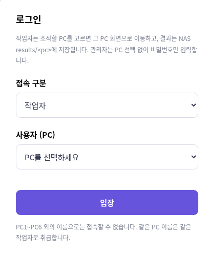

1. 브라우저에서 내 PC의 작업 화면 주소를 엽니다. 처음에 묻는 아이디·비밀번호는 관리자에게 받습니다.
2. **접속 구분**은 `작업자`로 둡니다.
3. **사용자 (PC)** 에서 내가 앉은 PC 이름(PC1 ~ PC6)을 고르고 **입장**을 누릅니다.

- 다른 PC 이름을 고르면 그 PC의 화면으로 넘어갑니다. 반드시 내가 쓰는 PC를 고르세요.
- 같은 PC 이름으로 들어온 사람은 같은 작업자로 취급됩니다.

## 2. 화면 구성

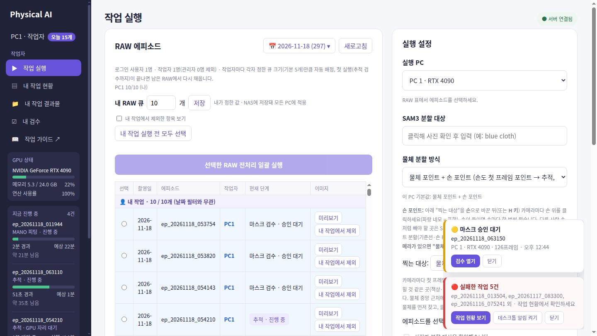

왼쪽 사이드바에서 화면을 바꿉니다.

| 메뉴 | 쓰는 때 |
|---|---|
| ▶ 작업 실행 | 새 RAW에 포인트를 찍고 실행할 때, 3D 복원 일괄 실행을 시작할 때 |
| ▤ 내 작업 현황 | 지금 어느 단계인지, 실패한 것이 있는지 볼 때 |
| 📁 내 작업 결과물 | 만들어진 파일을 열어볼 때 |
| ☑ 내 검수 | 마스크·추적 결과를 확인하고 승인할 때 |
| 📖 작업 가이드 | 이 문서 |

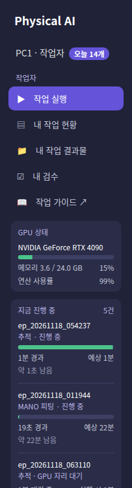

사이드바에는 어느 화면에서든 다음이 보입니다.

- **오늘 n개**: 오늘 추적 검수까지 끝낸 에피소드 수입니다.
- **GPU 상태**: 메모리와 연산 사용률입니다. 메모리가 꽉 차 있으면 새 작업이 기다립니다.
- **지금 진행 중**: 이 PC가 지금 돌리고 있는 단계와 남은 예상 시간입니다.
- **NAS 업로드**: 작업 파일을 NAS에 올리는 중일 때만 나옵니다. 올리는 에피소드의 진행률과 기다리는 개수가 보이고, 누르면 자세한 목록(8번)으로 갑니다.

알림(검수 필요, 실패)은 화면 **오른쪽 아래**에 뜹니다.

## 3. 내 RAW 확인

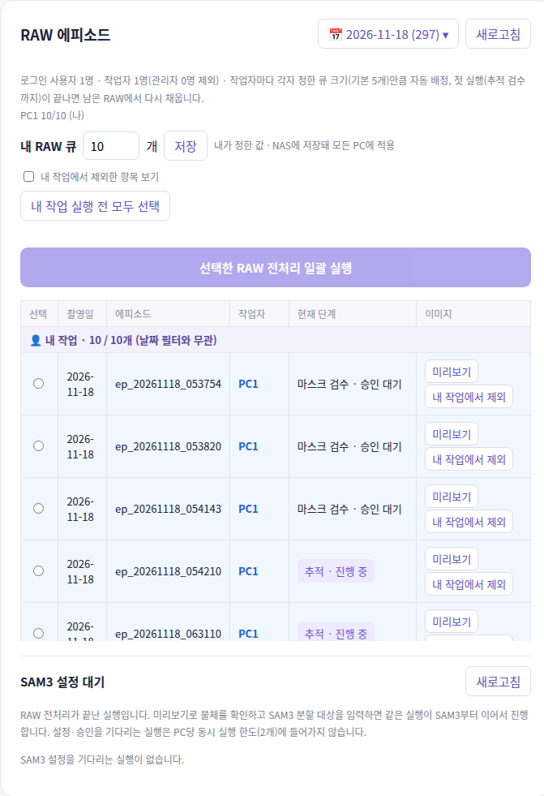

**작업 실행** 화면 위쪽 표에 내게 배정된 RAW가 나옵니다.

- 맨 위 `👤 내 작업` 묶음이 내 몫입니다. 정해 둔 큐 크기(기본 5개)만큼 자동으로 채워지고, 추적 검수까지 끝나면 남은 RAW에서 다시 채워집니다.
- **내 RAW 큐** 숫자를 바꾸고 **저장**하면 한 번에 받는 개수가 바뀝니다.
- **미리보기**를 누르면 오른쪽에 그 에피소드의 사진이 나옵니다.
- 촬영이 잘못되어 작업하면 안 되는 RAW는 **내 작업에서 제외**를 누릅니다. 실수로 눌렀으면 `내 작업에서 제외한 항목 보기`를 켜서 되돌립니다.

`현재 단계` 칸의 뜻은 다음과 같습니다.

| 표시 | 뜻 | 내가 할 일 |
|---|---|---|
| 배정됨 · 실행 전 | 아직 시작하지 않음 | 포인트 찍기 (4번) |
| SAM3 · 진행 중 | 물체·손 분할 중 | 기다리기 |
| 마스크 검수 · 승인 대기 | 분할이 끝남 | 마스크 검수 (5번) |
| 추적 검수 대기 | 추적에서 확인할 구간이 나옴 | 추적 검수 (6번) |
| 3D 복원 대기 | 추적 검수까지 끝남 | 일괄 실행 때 처리됨 (7번) |
| MANO 대기 | 3D 복원까지 끝남 | 일괄 실행 때 처리됨 (7번) |
| 전체 완료 | NAS 저장까지 끝남 | 없음 |
| ○○ · 실패 | 그 단계에서 멈춤 | 다시 실행 (8번) |

## 4. 물체·손에 포인트 찍기 (SAM3 연속 모드)

여러 개를 이어서 처리할 때는 **SAM3 연속 모드**를 씁니다. 평소에는 이 방법만 쓰면 됩니다.

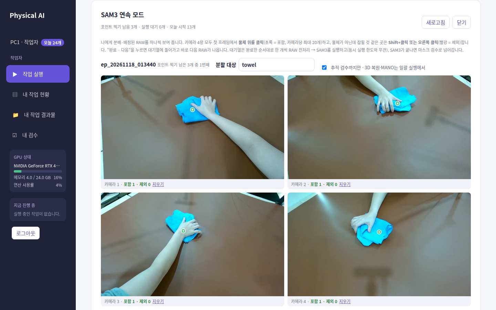

1. **작업 실행** 화면을 아래로 내려 **▶ 연속 모드 시작**을 누릅니다. 내 RAW가 하나씩 나옵니다.
2. **분할 대상**에 물체 이름이 영어로 채워져 있는지 봅니다(예: `towel`). 촬영 정보에서 자동으로 들어오며, 틀렸으면 고칩니다.
3. 카메라 4장 **모두**에서 물체 위를 클릭합니다. 초록 점이 찍힙니다.
4. **✓ 완료 · 다음**을 누릅니다. 이 RAW는 대기열에 들어가고 바로 다음 RAW가 나옵니다.

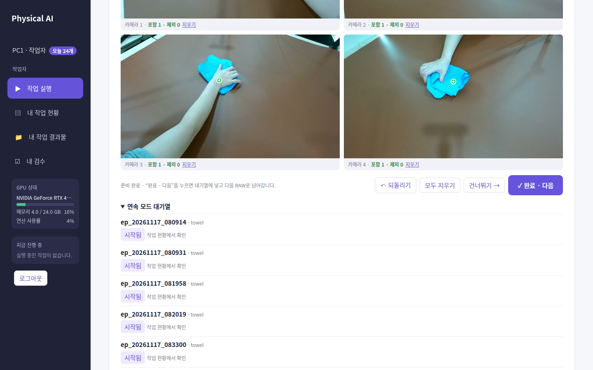

포인트를 잘 찍는 법:

- 물체 **가운데 근처**에 1~3개면 충분합니다. 가장자리나 손에 가려진 곳은 피합니다.
- 물체가 아닌데 같이 잡힐 것 같은 곳(책상, 손, 팔)은 **Shift+클릭** 또는 **오른쪽 클릭**으로 빨간 점(제외)을 찍습니다.
- 잘못 찍었으면 **↶ 되돌리기**, 그 카메라만 다시 하려면 사진 아래 **지우기**, 전부 다시 하려면 **모두 지우기**를 누릅니다.
- 카메라 4장 중 한 장이라도 초록 점이 없으면 완료할 수 없습니다.
- 지금 판단하기 어려운 RAW는 **건너뛰기 →** 로 넘깁니다.

**손 포인트도 찍는 PC** (사진 아래에 `찍는 대상: 물체 / 손` 버튼이 보이는 경우):

- 물체를 다 찍은 뒤 **손** 버튼(또는 `H` 키)으로 바꾸고, 카메라 4장 모두에서 손 위를 클릭합니다. 파랑 네모가 찍힙니다.
- 손이 둘이면 손마다 한 번씩 찍습니다. 다른 사람 손처럼 빼야 할 곳은 Shift+클릭 또는 오른쪽 클릭(주황)입니다.
- 사진 아래 `물체 n/4 · 손 n/4`가 모두 4/4가 되어야 완료할 수 있습니다.
- 첫 프레임에 손이 안 보이는 카메라가 있으면 찍지 말고 **건너뛰기 →** 로 넘긴 뒤 관리자에게 알립니다.

대기열에 들어간 RAW는 완료한 순서대로 한 개씩 `RAW 전처리 → SAM3`를 돌립니다. 끝나면 마스크 검수 알림이 뜹니다. 기다리는 동안 다음 RAW 포인트를 계속 찍으면 됩니다.

### 한 개만 따로 실행할 때

RAW 표에서 에피소드를 고르면 오른쪽 **실행 설정**에서 같은 작업을 한 개만 할 수 있습니다.

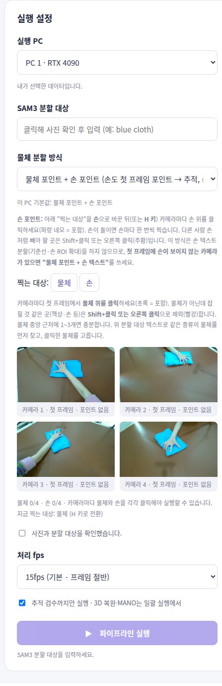

1. RAW 표에서 에피소드 왼쪽 동그라미를 누릅니다.
2. **SAM3 분할 대상**에 물체 이름을 영어로 적습니다(예: `blue towel`).
3. **물체 분할 방식**은 그대로 둡니다. PC마다 기본값이 정해져 있고, 바로 아래 `이 PC 기본값`에 표시됩니다.
4. 카메라 4장에 포인트를 찍습니다. 방법은 연속 모드와 같습니다(`찍는 대상` 버튼이 보이면 손도 찍습니다).
5. `사진과 분할 대상을 확인했습니다`를 체크합니다.
6. `추적 검수까지만 실행`은 **체크한 채로** 둡니다.
   - **처리 fps**는 기본값 `15fps`를 그대로 둡니다. 30fps로 촬영한 영상에서 프레임을 하나 걸러 하나만 써서 처리하며, 최종 결과도 15fps가 됩니다. 모든 프레임이 필요할 때만 `30fps`를 고릅니다. (전처리 일괄 실행·연속 모드에도 같은 값이 쓰입니다.)
7. **▶ 파이프라인 실행**을 누릅니다.

## 5. 마스크 검수

SAM3가 끝나면 화면 오른쪽 아래에 알림이 뜹니다. **검수 열기**를 누르거나 사이드바 **☑ 내 검수**로 들어갑니다.

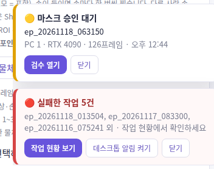

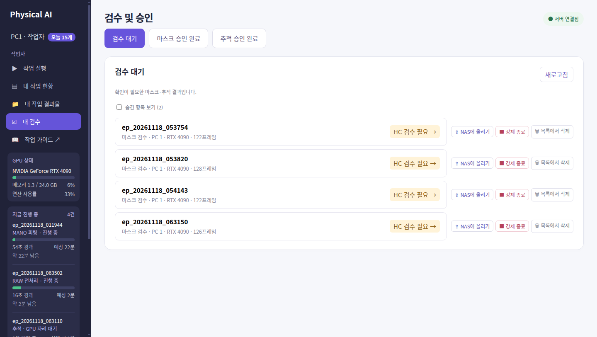

목록에서 에피소드를 누르면 검수 화면이 열립니다.

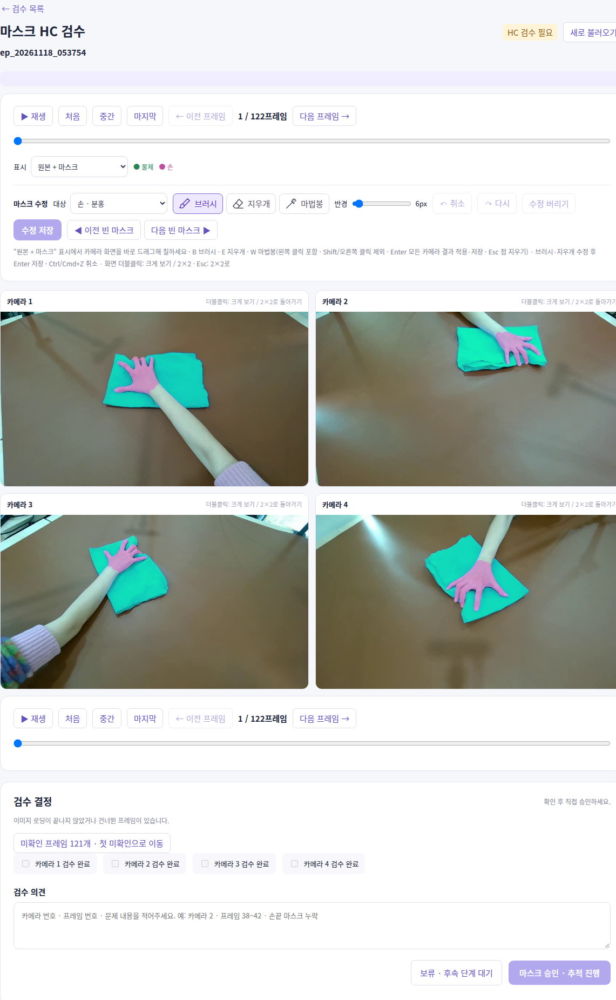

초록이 **물체**, 분홍이 **손** 마스크입니다. 모든 프레임에서 아래 세 가지를 봅니다.

- 물체 전체가 초록으로 덮였는가. 책상이나 배경까지 번지지 않았는가.
- 손이 손끝까지 분홍으로 덮였는가. 팔뚝이나 물체로 번지지 않았는가.
- 마스크가 통째로 빠진 프레임은 없는가.

### 보는 법

- **▶ 재생**으로 전체를 한 번 훑고, 이상한 곳에서 멈춰 **← 이전 프레임 / 다음 프레임 →** 으로 하나씩 봅니다.
- **표시**를 `원본 RGB`, `물체 마스크`, `손 마스크`로 바꾸면 따로 볼 수 있습니다.
- 카메라 화면을 **더블클릭**하면 크게 보이고, 다시 더블클릭하거나 `Esc`를 누르면 4분할로 돌아옵니다.
- **◀ 이전 빈 마스크 / 다음 빈 마스크 ▶** 는 마스크가 빠진 프레임으로 바로 이동합니다.

### 고치는 법

표시가 `원본 + 마스크`일 때 카메라 화면 위에서 바로 고칩니다.

1. **대상**에서 고칠 마스크(`손 · 분홍` 또는 `물체 · 초록`)를 고릅니다.
2. 도구를 고릅니다.

| 도구 | 단축키 | 쓰는 때 |
|---|---|---|
| 브러시 | `B` | 빠진 부분을 드래그해서 칠하기 |
| 지우개 | `E` | 번진 부분을 드래그해서 지우기 |
| 마법봉 | `W` | 클릭한 곳을 기준으로 마스크를 다시 만들기. 왼쪽 클릭 = 포함, Shift/오른쪽 클릭 = 제외 |

3. `Enter`를 누르거나 **수정 저장**을 누릅니다.

- 잘못 고쳤으면 `Ctrl+Z`(취소) 또는 **수정 버리기**를 씁니다.
- **반경**으로 브러시 크기를 바꿉니다.
- 다른 프레임이나 다른 화면으로 넘어가면 수정한 내용은 자동으로 저장됩니다.

### 승인

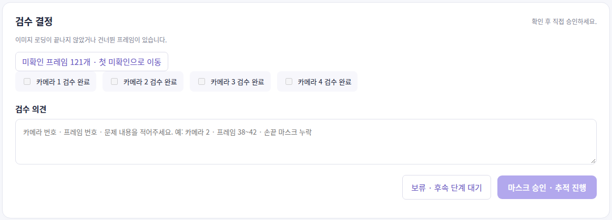

1. 모든 프레임을 봐야 합니다. 안 본 프레임이 있으면 `미확인 프레임 n개 · 첫 미확인으로 이동` 버튼이 나옵니다.
2. `카메라 1~4 검수 완료`를 모두 체크합니다.
3. **마스크 승인 · 추적 진행**을 누릅니다. 이어서 추적이 자동으로 시작됩니다.

고칠 수 없을 만큼 잘못됐으면 **검수 의견**에 `카메라 번호 · 프레임 번호 · 문제`를 적고(예: `카메라 2 · 프레임 38~42 · 손끝 마스크 누락`) **보류 · 후속 단계 대기**를 누른 뒤 관리자에게 알립니다.

> 승인한 마스크는 추적·3D 복원에 그대로 쓰입니다. 확신이 없으면 승인하지 말고 보류하세요.

## 6. 추적 검수

추적이 끝나면 자동 검사를 합니다. 문제가 없으면 **자동으로 승인**되어 `3D 복원 대기`로 넘어가고, 확인할 구간이 있을 때만 검수 목록에 `추적 검수`로 올라옵니다.

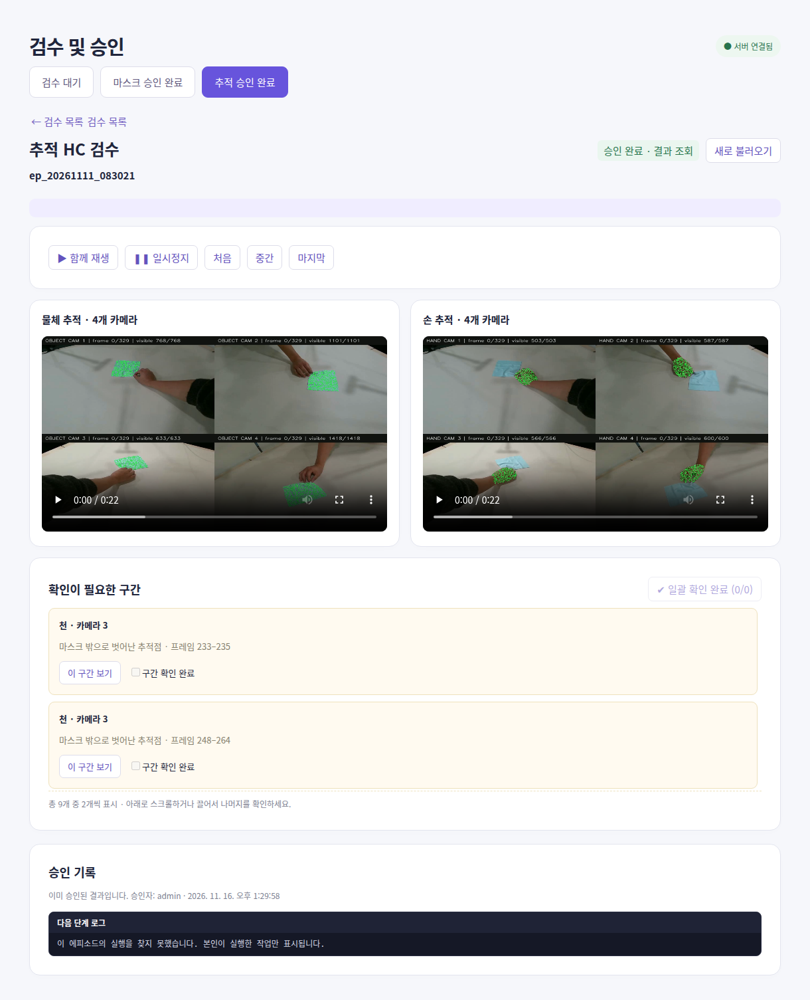

1. **▶ 함께 재생**으로 물체 추적과 손 추적 영상을 같이 봅니다. 점들이 물체와 손에 붙어서 따라가면 정상입니다.
2. **확인이 필요한 구간**의 항목마다 **이 구간 보기**를 눌러 그 프레임을 봅니다.
3. 괜찮으면 `구간 확인 완료`를 체크합니다. 모두 괜찮으면 **✔ 일괄 확인 완료**를 써도 됩니다.
4. 모든 구간을 확인한 뒤 승인합니다.

구간에 붙는 사유는 두 가지입니다.

| 사유 | 뜻 | 괜찮은 경우 |
|---|---|---|
| 마스크 밖으로 벗어난 추적점 | 점이 물체·손 밖으로 나감 | 몇 개만 잠깐 벗어났다 돌아옴 |
| 가림 또는 낮은 가시성 | 손이나 물체에 가려서 안 보임 | 실제로 가려진 구간임 |

점 대부분이 물체에서 떨어져 배경에 붙어 있으면 승인하지 말고 보류한 뒤 관리자에게 알립니다.

## 7. 3D 복원 일괄 실행

추적 검수까지 끝난 에피소드는 `3D 복원 대기`로 쌓입니다. 퇴근 전에 한 번 실행합니다.

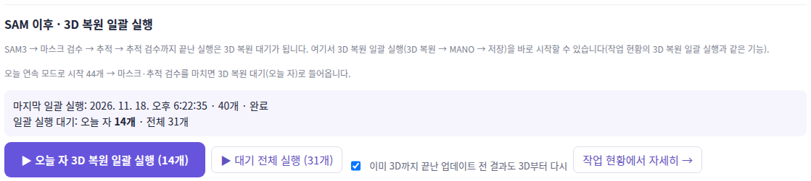

1. **작업 실행** 화면 맨 아래 **SAM 이후 · 3D 복원 일괄 실행**으로 갑니다.
2. `일괄 실행 대기: 오늘 자 n개`가 오늘 끝낸 개수와 맞는지 봅니다.
3. **▶ 오늘 자 3D 복원 일괄 실행**을 누릅니다. 지난 날짜 것까지 모두 돌리려면 **▶ 대기 전체 실행**을 누릅니다.

- 에피소드마다 `3D 복원 → MANO → NAS 저장`을 차례로 돌립니다. 사람이 볼 것은 없습니다.
- `이미 3D까지 끝난 업데이트 전 결과도 3D부터 다시`는 관리자가 요청할 때만 체크합니다.

## 8. 진행 상황과 실패 확인

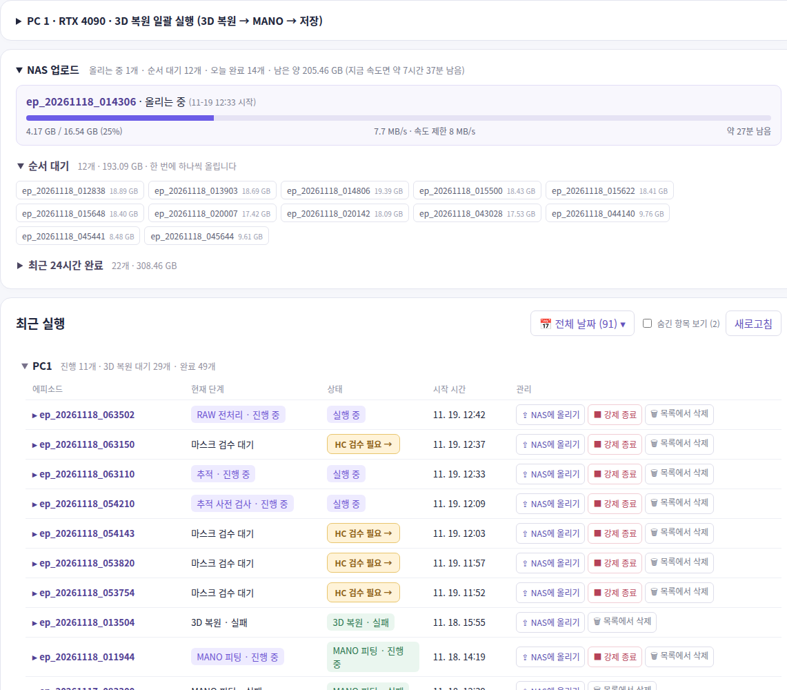

**▤ 내 작업 현황**에서 내 실행을 모두 봅니다.

- 목록은 위에서부터 **진행 중인 것**, `⏸ 3D 복원 대기`, `✔ 전체 완료`(시작한 날짜별) 순서입니다. 대기와 완료 묶음은 눌러서 펼칩니다.
- 오른쪽 위 **📅 전체 날짜**로 특정 날짜에 시작한 것만 볼 수 있습니다.
- 에피소드 이름 앞의 `▸`를 누르면 단계별 진행도와 로그가 펼쳐집니다.
- 상태가 **HC 검수 필요 →** 이면 눌러서 바로 검수 화면으로 갑니다.
- 상태가 **실패**이면 **↻ 다시 실행**을 누릅니다. 실패한 단계부터 다시 돌립니다.
- 맨 위 `3D 복원 일괄 실행` 줄을 펼치면 일괄 실행의 진행 로그가 나옵니다.

관리 칸의 버튼은 다음과 같습니다.

| 버튼 | 하는 일 | 주의 |
|---|---|---|
| ⇪ NAS에 올리기 | 이 PC 작업 폴더의 파일을 NAS에 올림 | 최종 결과는 자동으로 저장되므로 평소에는 누를 일이 없음 |
| ■ 강제 종료 | 대기·실행 중인 실행을 멈춤 | 관리자가 요청할 때만. 나중에 다시 실행으로 이어갈 수 있음 |
| 🗑 목록에서 삭제 | 목록에서만 숨김 | 파일과 기록은 그대로 남고 `숨긴 항목 보기`에서 되돌림 |

같은 에피소드가 다시 실행해도 또 실패하면 더 누르지 말고, 에피소드 이름과 실패한 단계를 관리자에게 알립니다.

### NAS 업로드 확인

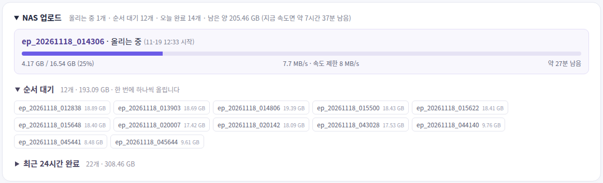

최종 저장까지 끝난 에피소드는 작업 폴더를 자동으로 NAS에 올립니다. **NAS 업로드** 줄을 펼치면 진행 상황이 나옵니다.

- 업로드는 **한 번에 하나씩** 합니다. 맨 위가 지금 올리는 에피소드(진행률·속도·남은 시간)이고, `순서 대기`는 차례를 기다리는 에피소드입니다.
- PC에 따라 낮(평일 근무 시간)에는 화면이 느려지지 않도록 속도를 제한해서 올립니다. 이때는 `속도 제한 n MB/s`가 함께 표시됩니다.
- `실패 · 중단`에 에피소드가 보이면 그 에피소드의 **⇪ NAS에 올리기**를 눌러 다시 올립니다.
- 사람이 따로 할 일은 없습니다. 다만 올리는 중이거나 대기가 남아 있으면 PC를 끄지 않습니다.

## 9. 결과물 확인

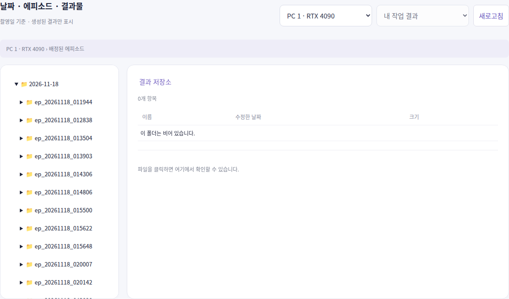

**📁 내 작업 결과물**에서 날짜 → 에피소드 → 폴더 순으로 들어가 파일을 봅니다. 파일을 누르면 아래에서 바로 열리고 **다운로드**로 받을 수 있습니다. 평소 작업에서는 열어볼 필요가 없습니다.

---

## 자주 묻는 것

**알림이 떴는데 닫아 버렸어요.**
사이드바 **☑ 내 검수**의 `검수 대기` 목록에 그대로 있습니다.

**검수 목록이 비어 있는데 `숨긴 항목 보기 (n)`가 보여요.**
목록에서 삭제한 항목입니다. 눌러서 다시 꺼낼 수 있습니다.

**포인트를 찍고 완료했는데 물체가 틀린 걸 나중에 알았어요.**
마스크 검수에서 마법봉으로 물체를 다시 잡아 고칩니다. 고치기 어려우면 보류하고 관리자에게 알립니다.

**`지금 진행 중`이 한참 동안 안 바뀌어요.**
예상 시간의 두 배가 넘도록 그대로면 **내 작업 현황**에서 그 에피소드를 펼쳐 로그가 멈췄는지 보고 관리자에게 알립니다.

**어제 끝난 에피소드가 NAS에 올라갔는지 알고 싶어요.**
**내 작업 현황 → NAS 업로드**를 펼쳐 `최근 24시간 완료`에 있는지 봅니다. `순서 대기`에 있으면 아직 차례를 기다리는 중입니다.

**내 RAW가 0개예요.**
남은 RAW가 없거나 아직 배정되지 않은 것입니다. **새로고침**을 눌러 보고, 그래도 없으면 관리자에게 물어봅니다.

## 하지 말아야 할 것

- 내 PC가 아닌 이름으로 로그인하지 않습니다.
- 다 보지 않은 마스크를 승인하지 않습니다.
- 관리자 요청 없이 **■ 강제 종료**를 누르지 않습니다.
- 일괄 실행이 돌거나 NAS 업로드가 남아 있는 동안 PC를 끄지 않습니다.
